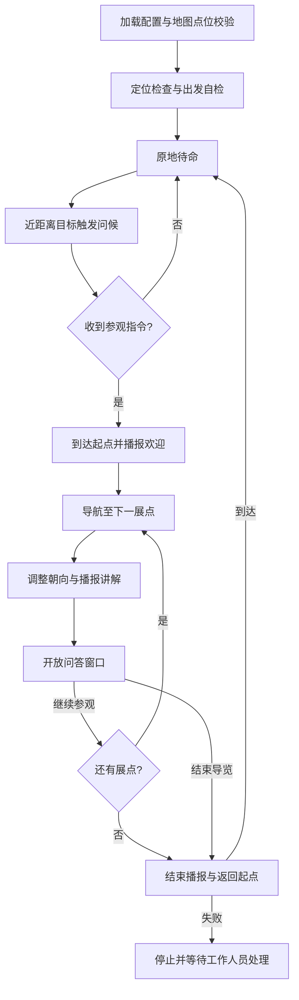
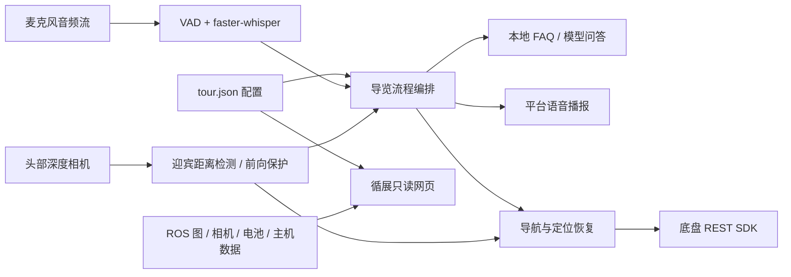
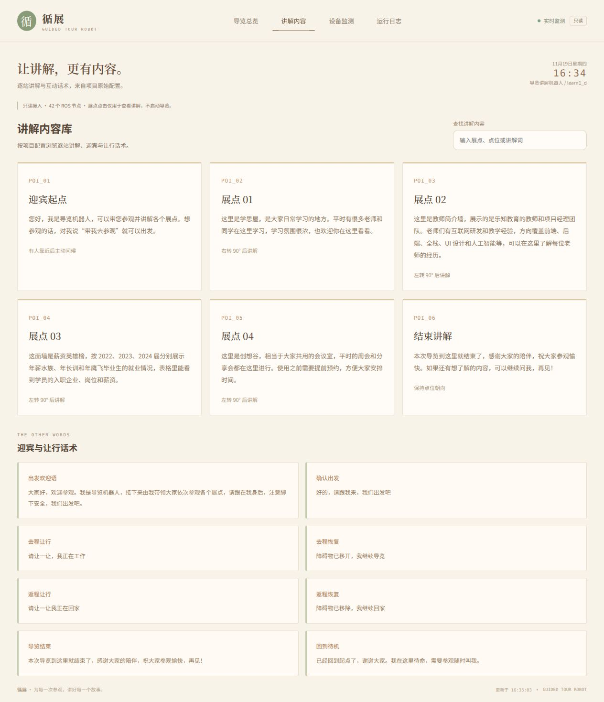
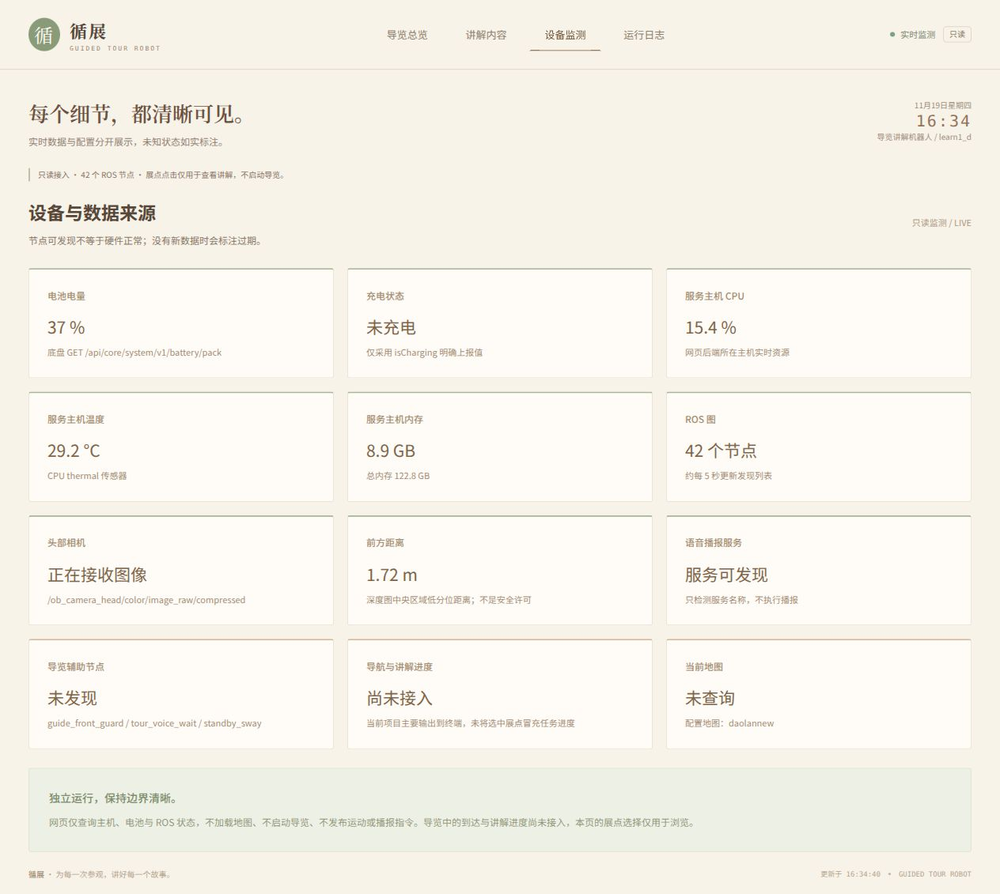
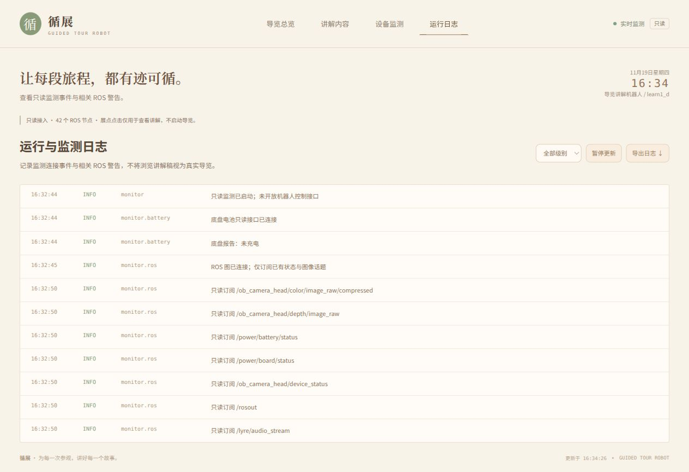

# 天轶2.5 · 导览讲解机器人

**Guided Tour Robot｜固定路线参观 · 逐站讲解 · 展点问答 · 结束返程**

基于 ROS 2 与 Python，在天轶2.5 机器人上实现从迎宾到返程的导览流程。游客靠近后主动问候，收到参观指令后依次前往展点，到点讲解并开放问答，最后返回起点待命。路线、讲解词和问答资料集中配置，配套「循展」网页工作台用于查看内容与设备状态。

[实机演示](#实机演示) · [功能介绍](#功能介绍) · [快速开始](#快速开始) · [网页预览](#网页预览) · [代码入口](#代码入口)

技术栈：**ROS 2 Jazzy / Python 3 / 底盘 REST SDK / faster-whisper / OpenAI 兼容模型接口 / HTML、CSS、JavaScript**

> 本仓库用于按固定路线参观讲解。按游客指定目的地带路的另一个项目见 [visitor_wayfinding_robot](https://github.com/cisyam555/visitor_wayfinding_robot)。

## 实机演示

天轶2.5 导览现场视频，完整时长约 **5 分 43 秒**。

https://github.com/user-attachments/assets/2f3e640e-99fb-4a11-b1e9-997db686c7c7

[下载原版 MP4（约 35 MB）](https://github.com/cisyam555/guided_tour_robot/raw/refs/heads/main/docs/videos/guided-tour-demo.mp4)。视频用于展示现场运行效果，不替代各项功能的独立验收。

## 功能介绍

| 能力 | 实现方式 |
| --- | --- |
| 靠近迎宾 | 头部深度相机检测正前方近距离目标，默认 0.8 m 内连续 3 帧确认后问候；属于距离触发，不是人脸或身份识别 |
| 语音启动 | 订阅麦克风音频流，使用 VAD 断句与本地 faster-whisper，识别参观关键词 |
| 固定路线参观 | 校验地图和点位，通过底盘 REST 接口执行点对点导航，到点调整朝向 |
| 逐站讲解 | 根据点位配置转向展品、播报讲解词，完成后恢复点位朝向 |
| 展点问答 | 每段讲解后开放提问窗口，优先匹配本地 FAQ，其余问题调用模型并提供展点资料 |
| 结束返程 | 正常结束或在问答窗口收到结束指令后，返回配置的起点待命 |
| 出发与行驶保护 | 检查电量、定位置信度和深度出帧；启用 AEB、前方深度停车、超时与有限重试 |
| 网页监测 | 独立只读服务，展示路线内容、相机、主机与电池数据及监测日志 |

默认地图为 `daolannew`，路线包含 1 个起点与 5 个讲解点：

```text
POI_01 → POI_02 → POI_03 → POI_04 → POI_05 → POI_06 → POI_01
起点          依次参观与讲解五个展点                     返回待命
```

本项目使用地图点位导航；实际行驶路径由底盘规划，不保证复现录制轨迹。

## 交互与任务流程



| 交互阶段 | 示例说法 | 预期行为 |
| --- | --- | --- |
| 待命收音 | “带我去参观”“给我讲解”“出发” | 开始导览 |
| 展点问答 | “这里是做什么的？” | 根据 FAQ 或提供给模型的资料回答 |
| 展点问答 | “继续”“下一个”“没有了” | 结束本次问答，继续路线 |
| 展点问答 | “结束导览”“不听了”“回去吧” | 结束后续参观并返程 |

语音指令受收音阶段限制。播报时会抑制收音以减少回声，当前不承诺行驶和播报期间随时语音打断；结束指令应在问答窗口内说出。

## 系统组成



ROS 2 负责节点与平台接口集成；导航通过厂商 SDK 提交异步任务，并跟踪任务状态。模型负责问答文本，路线与底盘操作由程序控制。

## 快速开始

### 1. 准备运行环境

实机部署需要：

- 天轶2.5 平台、ROS 2 Jazzy 与已配置的 `xos` 工作区。
- 厂商 `robot_controller` Python SDK，默认位于 `/home/nvidia/robot_controller/src`；非默认路径使用 `ROBOT_CONTROLLER_SRC` 环境变量指定。
- Python 依赖 `numpy`、`faster-whisper`，以及可用的本地识别模型。
- 已运行的头部 RGB/深度相机、`/lyre/audio_stream` 音频流与平台 TTS 服务。
- 底盘已保存 `daolannew` 地图及配置引用的点位。问答模型服务地址在 `tour.json` 中配置。

这些平台依赖不包含在本仓库中；新机器需先按厂商资料完成环境部署。

### 2. 克隆与构建

在机器人终端运行：

```bash
git clone https://github.com/cisyam555/guided_tour_robot.git
cd guided_tour_robot
source /opt/ros/jazzy/setup.bash
source /home/nvidia/xos/setup.bash
colcon build --packages-select learn1_d --symlink-install
source install/setup.bash
```

仓库名称是 `guided_tour_robot`，内部 ROS 2 包名沿用 `learn1_d`。

### 3. 先校验路线，再检查定位

```bash
# 只读校验地图与点位，不启动运动、播报或重定位
bash run_tour.sh plan:=true

# 仅执行地图与定位检查/恢复，不执行导览导航和播报
bash run_tour.sh localization_only:=true
```

正常定位时保留当前定位，不会因为启动导览就强行把机器人设为起点。若定位需要恢复，且机器人确实位于 `POI_01` 并与该点朝向一致，可显式提供已知位置：

```bash
bash run_tour.sh localization_only:=true reloc_poi:=POI_01
```

`localization_only` 可能加载地图或提交重定位任务，和只读的 `plan` 不同。已知点位提示不能代替真实位置；当前实现不保证任意位置的全局自动重定位。

### 4. 启动导览

确认地图、定位、相机与底盘就绪后运行：

```bash
bash run_tour.sh
```

默认进入原地待命，游客靠近触发问候，收到“带我去参观”等指令后开始。脚本会加载环境并把终端输出保存到 `log/tour_run_*.log`。

也可以在环境已加载后直接启动 ROS 2 launch：

```bash
ros2 launch learn1_d tour.launch.py
```

## 参数与内容配置

主要内容集中在 [tour.json](src/learn1_d/learn1_d/tour.json)：

| 配置项 | 用途 |
| --- | --- |
| `route` / `map` | 路线标识与底盘地图名称 |
| `start` / `pois` / `return_poi` | 起点、依次访问的展点与返回点 |
| `poi_scripts` | 各点位转向角、讲解词与问答知识 |
| `voice` | 问候词、启动关键词、迎宾距离和收音设置 |
| `qa` | 问答开关、提问窗口、FAQ、公共知识及模型服务设置 |
| `texts` | 欢迎、到达、结束、让行与续行话术 |

单个展点可按以下结构编辑（合并到现有配置，保留其他字段）：

```json
{
  "poi_scripts": {
    "POI_02": {
      "turn_deg": 30,
      "text": "这里是我们的第一个展点。",
      "knowledge": ["这里只填写已确认的展点资料。"]
    }
  }
}
```

常用启动参数：

| 参数 | 默认值 | 含义 |
| --- | --- | --- |
| `speed` | `0.3` | 导航限速，单位 m/s |
| `turn_w` | `0.3` | 原地转向角速度，单位 rad/s |
| `timeout` | `180.0` | 单段导航超时，单位秒 |
| `guard_distance` | `0.5` | 前进方向深度保护距离，单位米 |
| `turn_distance` | `0.3` | 转向时深度保护距离，单位米 |
| `wait_voice` | `true` | 等待语音启动导览 |
| `reloc_poi` | 空 | 显式指定重定位参考点位 |
| `plan` | `false` | 仅只读校验路线 |
| `localization_only` | `false` | 仅检查/恢复定位 |

例如降低导航限速：

```bash
bash run_tour.sh speed:=0.2
```

全部参数以 [tour.launch.py](src/learn1_d/launch/tour.launch.py) 为准。更换地图时，应同时更新路线标识与点位；自定义路线参数需按代码的校验要求使用 `route:=custom`。

## 网页预览


「循展」是本项目的独立只读工作台，提供导览配置浏览、讲解内容检索、实时相机与设备监测。以下四张截图于 **2026 年 11 月 19 日连接机器人后实机采集**，记录当时的网页状态。

### 导览总览：路线、相机与讲解预览


- **实时视野**：查看头部相机画面，并在随行状态栏查看电量、CPU、温度和内存。
- **参观目录**：展示 `daolannew` 路线的起点、逐站展点及返回起点的配置。
- **讲解预览**：点击章节或前后翻页，浏览该展点的讲解词与转向配置。
- **迎宾与检查**：展示问候语、启动关键词、靠近距离及配置中的检查阈值。

章节选择仅用于阅读讲解稿，不会启动导航或播报，也不代表机器人当前到达的展点。定位接口尚未接入，页面中的检查信息不能单独作为出发依据。

### 讲解内容：逐站稿件与互动话术



- **逐站讲解**：集中浏览迎宾起点、各展点与结束讲解，核对点位编号、讲解内容及转向说明。
- **内容检索**：按展点、点位或讲解词查找内容。
- **互动话术**：查看出发欢迎、确认出发、去返程让行、恢复行走、结束及回到待机的配置话术。

内容来自项目的 `tour.json`，网页用于浏览；修改讲解词请编辑项目配置文件。

### 设备监测：主机、相机与服务状态



- **主机与电池**：查看电量、充电状态、CPU、温度和内存，并标明数据来源。
- **ROS 与相机**：查看节点数量、头部相机接收情况、深度图前方距离与语音服务发现情况。
- **未接入项目**：明确标注导航与讲解进度尚未接入、当前运行地图未查询，避免将配置值误认为运行状态。

节点或服务可发现表示监测到了对应接口，不等于完成实机功能验证。

### 运行日志：监测连接与 ROS 警告



- 按时间查看监测服务启动、电池连接、ROS 图连接及话题订阅等事件。
- 支持按 `INFO`、`WARN`、`ERROR` 筛选，暂停更新和导出日志。
- 目前收集监测连接事件与相关 ROS 警告，机器人终端中的完整导览输出尚未接入。

启动和访问方法见下方启动说明，更多说明见 [Web 工作台文档](web/README.md)。


### 启动网页工作台

在机器人项目目录运行，浏览器访问 `http://<机器人IP>:8767/`：

```bash
bash web/start_monitor.sh --port 8767
```

在没有机器人硬件的电脑上也可预览配置页面：

```bash
python3 web/monitor.py --preview --bind 127.0.0.1 --port 8767
```

访问 `http://127.0.0.1:8767/`。预览模式不提供实机数据。网页为只读监测工具，不会通过选择章节启动导航或播报。详细依赖和数据边界见 [Web README](web/README.md)。

## 代码入口

建议按“配置 → 编排 → 导航 → 交互”的顺序阅读：

- [run_tour.sh](run_tour.sh)：实机启动与日志保存。
- [tour.launch.py](src/learn1_d/launch/tour.launch.py)：启动参数与节点入口。
- [tour.json](src/learn1_d/learn1_d/tour.json)：路线、讲解与问答资料。
- [map_nav_test.py](src/learn1_d/learn1_d/map_nav_test.py)：完整导览流程编排。
- [nav_core.py](src/learn1_d/learn1_d/nav_core.py)：定位、导航、转向、任务等待与异常处理。
- [front_guard.py](src/learn1_d/learn1_d/front_guard.py)：前方深度保护。
- [voice_wait.py](src/learn1_d/learn1_d/voice_wait.py) / [mic_asr.py](src/learn1_d/learn1_d/mic_asr.py)：待机收音、VAD 与本地识别。
- [poi_qa.py](src/learn1_d/learn1_d/poi_qa.py)：展点问答与继续/返程意图。
- [web/README.md](web/README.md)：网页部署与数据说明。

## 验证与故障排查

无需机器人运动的本地检查：

```bash
python3 -m unittest discover -s test -v
(cd web && python3 -m unittest test_monitor -v)
bash -n run_tour.sh
node --check web/app.js
```

单元测试检查程序逻辑，不代表实机定位精度、避障或语音识别率已通过验收。实机验证应依次检查路线、定位、单点导航、播报、问答和完整返程。

| 现象 | 排查方向 |
| --- | --- |
| 定位持续等待或接口返回 HTTP 500 | 查看实际定位状态、返回任务标识与底盘日志；`accepted=true` 不代表任务成功，也不应立即无限重复提交 |
| 机器人短距离反复停车 | 结合深度保护、导航状态和进度检测日志判断；检查前方障碍、深度异常与定位波动 |
| 无法识别参观指令 | 检查音频话题、识别模型与当前收音阶段；播报期间收音会被抑制 |
| 问答失败 | 检查 `qa` 模型服务配置与网络；失败时使用兜底话术并结束当前问答 |
| 网页无实时画面 | 检查 ROS 环境和相机话题；网页预览模式本身不连接硬件 |
| 返程失败 | 机器人停止后由工作人员排查，不把失败当作已回到待命点 |

## 当前边界与后续方向

- 迎宾使用深度距离触发，尚未实现人员身份识别、多目标跟踪或游客跟随检测。
- 语音交互按阶段开放，后续可增加可靠的播报打断与行驶中指令处理。
- 地图与点位依赖底盘已有数据；无法承诺任意位置恢复定位或严格沿固定轨迹行驶。
- 网页尚未接入真实任务进度、当前运行地图与全部导览终端日志。
- 前向深度保护与 AEB 是现有保护措施，仍需结合实际场地测试和平台使用要求。

## 贡献与许可

欢迎通过 Issue 提交可复现问题，附上运行环境、启动命令、相关日志与预期行为；提交日志前移除凭据和私人信息。代码修改建议先通过本地检查，再按功能拆分提交，使用 `feat:`、`fix:`、`docs:` 等提交类型。

本仓库尚未指定开源许可证；平台 SDK、模型与其他依赖遵循各自许可。复用、分发或商用前请先与作者确认授权。
