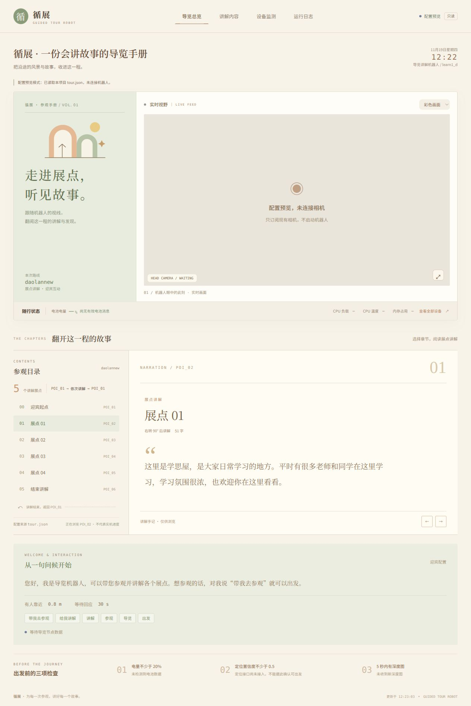

# guided_tour_robot —— 定点讲解导览机器人

按固定路线依次带访客到各展点，到点讲解并开放大模型问答，最后返回起点待命。
路线、点位、讲解词、问答资料、让行话术全部由 `tour.json` 驱动，改内容不需要改代码。

- ROS 2 Jazzy / ament_python 包名：`learn1_d`
- 默认路线 `daolannew`：`POI_01` 出发 → `POI_02` ~ `POI_06` → 返回 `POI_01`
- 默认使用点对点导航（`move_to_poi`），不依赖录制轨道

## 网页预览

导览讲解工作台的页面效果，包含任务或路线展示、相机区域及设备状态。截图为本地页面预览，实时数据需连接机器人后显示。



网页启动与使用方法见 [Web 工作台说明](web/README.md)。

## 功能

- **待机迎宾**：启动后原地静止待机（默认不晃动）；头部深度相机检测到有人进入
  0.8 m（连续 3 帧确认）就主动问候，然后等待语音指令。
- **语音启动**：复用平台语音识别（`/audio_asr/keyword`、`/audio_asr/iat`），
  命中「带我去参观」等关键词才开始导览；识别开关由节点持续使能。
- **固定路线导览**：起点摆正 → 依次前往各点位 → 到点摆正 → 按配置转向展品并讲解
  → 讲完转回点位朝向 → 下一点位；最后播结束语并返回起点。
- **点位讲解**：`tour.json` 的 `poi_scripts` 支持每个点位配置 `turn_deg`、`text`
  和 `knowledge`，没有专属讲解的点位使用统一的到达提示。
- **大模型问答**：每段讲解结束后开放 10 秒提问窗口，游客可以连续提问；
  展点问题只按资料回答，闲聊走通用对话，模型不可用时播兜底话术，不阻断导览。
- **结束导览返程**：问答窗口内说「不听了 / 结束导览 / 带我回去」，
  立即停止后续点位并返回起点待命。
- **前向防撞**：头部深度相机检测正前方障碍，绕不过去时停车让行并播报；
  障碍移开后播报续行再继续。去程和回程使用不同话术。
- **出发自检**：电量、定位置信度、深度图出帧三项检查，任一不满足就拒绝出发。
- **分级降级**：单点导航失败只跳过该点；摆正/讲解转向失败只跳过该步骤；
  连续 2 个点位失败或安全功能失效才中止整场导览。
- **异常善后**：任何中止都会先停稳，再播报「请联系工作人员」，不会无提示退出。

## 目录结构

```
guided_tour_robot/
├── src/learn1_d/
│   ├── launch/tour.launch.py       一键启动，所有参数可命令行覆盖
│   ├── learn1_d/
│   │   ├── map_nav_test.py         导览流程编排（命令行入口）
│   │   ├── nav_core.py             底盘交互：导航等待、定位、转向、防撞、自检
│   │   ├── tour_config.py          参数常量、tour.json 读取与校验
│   │   ├── tour.json               路线、讲解词、问答资料、话术、待机配置
│   │   ├── front_guard.py          前向深度防撞（FrontGuard / GuardNode）
│   │   ├── voice_wait.py           语音待机与问答收音（平台 ASR）
│   │   ├── poi_qa.py               点位问答：提示词、回声过滤、结束/返程意图
│   │   ├── qwen.py                 vLLM（OpenAI 兼容）最小客户端
│   │   ├── standby_sway.py         可选：待机腰部摇晃（默认关闭）
│   │   └── speak_test.py           TTS 播报工具（供 nav_core 复用）
│   ├── package.xml
│   └── setup.py
├── build/                          构建产物
└── install/                        安装产物
```

## 环境依赖

- ROS 2 Jazzy
- 平台工作空间 `/home/nvidia/xos`（提供 `lyre_msgs`、`interaction_msgs`、`ros2_bridge_msgs`）
- 底盘 SDK：`robot_controller`（默认 `/home/nvidia/robot_controller/src`，
  可用 `ROBOT_CONTROLLER_SRC` 覆盖）
- Python：`numpy`（防撞模块处理深度图）；语音识别由平台提供，本包不依赖 faster-whisper
- 底盘 REST 服务：默认 `http://192.168.11.10:9090`
- 头部深度相机：`/ob_camera_head/depth/image_raw`
- 大模型：远程 vLLM，默认 `http://120.48.75.178:7006/v1`，模型 `Qwen3.5-122B-A10B`
- 腰部控制：`/waist/cmd`（仅在使用待机摇晃时需要）

## 构建

```bash
cd /home/nvidia/guide_robot/learn/guided_tour_robot
source /opt/ros/jazzy/setup.bash
source /home/nvidia/xos/setup.bash

# IDE 内置终端如报 GLIBCXX 相关错误，先清掉 IDE 注入的库路径
# unset LD_LIBRARY_PATH

colcon build --packages-select learn1_d --symlink-install
source install/setup.bash
```

如果编译报错 `can't open file '.../build/learn1_d/setup.py'`，说明 `build/`、`install/`
是从别的目录复制来的旧产物，里面的软链接还指向旧路径。清掉后重编即可：

```bash
rm -rf build/learn1_d install/learn1_d
colcon build --packages-select learn1_d --symlink-install
```

## 运行

```bash
source /opt/ros/jazzy/setup.bash
source /home/nvidia/xos/setup.bash
source /home/nvidia/guide_robot/learn/guided_tour_robot/install/setup.bash

ros2 launch learn1_d tour.launch.py
```

默认行为：加载 `daolannew` 地图 → 自检 → 原地待机（不晃动） → 有人靠近先问候 →
听到「带我去参观」后开始导览 → 逐点讲解并开放问答 → 走完返回起点 → 播结束语后继续待机，不退出。

常用覆盖：

```bash
# 只校验路线，不加载地图、不运动、不播报
ros2 launch learn1_d tour.launch.py plan:=true

# 降低速度、关闭语音播报
ros2 launch learn1_d tour.launch.py speed:=0.15 speak:=false

# 跳过语音待机，自检通过后直接开始导览（调试用）
ros2 launch learn1_d tour.launch.py wait_voice:=false

# 只测试待机问候，收到启动指令就退出，不移动
ros2 launch learn1_d tour.launch.py standby_only:=true

# 强制重定位，并校验最终位姿
ros2 launch learn1_d tour.launch.py reloc:=true reloc_poi:=POI_01

# 关闭前向防撞（不建议）
ros2 launch learn1_d tour.launch.py guard:=false

# 临时恢复待机摇晃
ros2 launch learn1_d tour.launch.py sway_deg:=10.0

# 换一份路线配置
ros2 launch learn1_d tour.launch.py config:=/path/to/other.json
```

单独使用底层工具：

```bash
# 列出当前地图的点位与轨道，不移动
ros2 run learn1_d map_nav_test --list
ros2 run learn1_d map_nav_test --map daolannew --list

# 按命令行点位跑一趟
ros2 run learn1_d map_nav_test --map daolannew \
  --start POI_01 --pois POI_02,POI_03 --return-poi POI_01 \
  --reloc-poi POI_01

# 关闭点位问答（直接跑命令行时）
ros2 run learn1_d map_nav_test --no-qa

# 单独测试 TTS
ros2 run learn1_d speak_test "测试播报" --interrupt
```

## 导览流程

1. **参数校验**：读取 `tour.json`，套用固定路线，校验速度、超时、距离等数值范围。
2. **只读检查**：核对地图上的点位/轨道是否齐全，缺项直接拒绝，不会先切图。
3. **加载地图**：当前地图不是目标地图时调用 `start_localization`，已是当前地图则跳过。
4. **定位**：`slam_status` 为 1/2/3/5 时按 `--pose` / `--reloc-poi` / `--start`
   的坐标下发重定位；`--reloc` 会强制重新匹配并校验结果。
5. **底盘健康**：`hasFatal` / `hasError` 为真则拒绝导航（`--standby-only` 除外）。
6. **运动配置**：开启 AEB，设置限速；启动前向防撞。
7. **出发自检**：电量 <20%、定位置信度 <0.5、5 秒内无深度图，任一不满足即拒绝出发。
8. **待机**：静止不晃动 + 有人靠近问候 + 等待语音指令；超时回到待机继续等。
9. **导览**：不在起点时先导航到起点 → 播欢迎语 → 起点摆正 → 逐点执行
   「导航 → 摆正 → 转向展品 → 讲解 → 问答 → 回正」。
10. **收尾**：最后一点播结束语 → 返回起点并摆正 → 播 `done_text` → 继续待机。

问答窗口内如果听到「不听了 / 结束导览 / 带我回去」，跳过剩余点位和结束语，
直接返回起点待命，然后重新进入待机。

## 大模型问答

### 触发时机

- 每个点位讲解播报结束、回声清理完成后，开启 **10 秒**聆听窗口。
- 窗口内可以连续提问，不限轮数；连续 10 秒没人说话才继续前往下一点位。
- 回答由 TTS 播报，单条限制 80 字，适合直接朗读。
- 讲解播报期间和点位间行走途中不收音，避免机器人听到自己的声音或把路人闲聊当成指令。

### 回答范围

- **展点/公司相关问题**：只依据 `tour.json` 里的资料回答，不编造数字、姓名、薪资。
- **资料外的问题**：回答「这个我不太清楚，可以问问现场的老师」。
- **打招呼、闲聊、一般常识**：自然回应一两句；政治、宗教、医疗、法律、投资等敏感话题
  礼貌带过并把话题引回参观。
- 常用指令走本地关键词匹配，不调用大模型；只有真正的提问才请求模型。

### 结束与返程

| 游客说的话 | 机器人行为 |
| --- | --- |
| 谢谢 / 继续 / 下一个 / 走吧 | 结束当前问答，继续下一个点位 |
| 不听了 / 不想听了 / 别讲了 | 结束整场导览，返回起点待命 |
| 结束导览 / 结束参观 | 结束整场导览，返回起点待命 |
| 带我回去 / 回去吧 / 回起点 / 回原点 | 结束整场导览，返回起点待命 |

返程统一回到 `return_poi`（默认 `POI_01` 乐知教育），到点摆正后进入待机。

### 资料配置

每个点位的问答资料放在 `poi_scripts.<点位>.knowledge`，公司通用资料放在
`qa.common_knowledge`。通用资料在每个点位都会生效，所以教师介绍、公司简介这类
跨点位内容放在 `common_knowledge` 最合适。

提示词规则：优先按资料回答；资料没有就明确说不知道；口语化、不用列表；
不暴露“资料”“根据提供的信息”这类词。

### 模型不可用时

- 请求超时或网络断开：播报 `qa.no_answer`，结束本次问答，不阻断导览。
- 修改 `qa.base_url` / `qa.model` / `qa.timeout` 即可切换模型或调整超时。
- 关闭问答：把 `qa.enabled` 改成 `false`；直接跑命令行时也可加 `--no-qa`。

## tour.json 配置

```json
{
  "route": "daolannew",
  "map": "daolannew",
  "start": "POI_01",
  "pois": ["POI_02", "POI_03", "POI_04", "POI_05", "POI_06"],
  "return_poi": "POI_01",
  "texts": {
    "greet": "出发前的欢迎语",
    "arrival": "已到达 {poi}",
    "farewell": "结束语",
    "yield": "请让一让，我正在工作",
    "resume": "障碍物已移开，我继续导览",
    "return_yield": "请让一让我正在回家",
    "return_resume": "障碍物已移除，我继续回家"
  },
  "voice": {
    "standby_text": "无人靠近时的引导语",
    "welcome_text": "有人靠近时的问候语",
    "ready_text": "确认出发时的应答",
    "done_text": "回到起点后的结束语",
    "wake_words": ["带我去参观", "给我讲解", "讲解", "参观", "导览", "出发"],
    "presence_distance": 0.8,
    "listen_timeout": 30.0
  },
  "qa": {
    "enabled": true,
    "listen_seconds": 10.0,
    "base_url": "http://120.48.75.178:7006/v1",
    "model": "Qwen3.5-122B-A10B",
    "timeout": 6.0,
    "max_reply_chars": 80,
    "chitchat": true,
    "no_answer": "这个我暂时答不上来，可以问问现场的老师。",
    "end_words": ["不用了", "没有了", "谢谢", "继续", "走吧", "下一个"],
    "abort_words": ["不听了", "不想听了", "结束导览", "带我回去", "回去吧"],
    "common_knowledge": ["关于乐知教育的通用资料，每个点位都能用到"]
  },
  "poi_scripts": {
    "POI_02": {
      "turn_deg": -90.0,
      "text": "讲解词",
      "knowledge": ["该点位的问答资料"]
    },
    "POI_06": { "turn_deg": 0.0, "text": "本次导览到这里就结束了……" }
  }
}
```

- `route` / `map` / `start` / `pois` / `return_poi` / `texts` 缺失会直接报错；
  `voice`、`qa`、`poi_scripts` 可省略，使用内置默认值。
- `turn_deg`：到点摆正后相对车头转动角度，负值右转、正值左转。
- 最后一点若在 `poi_scripts` 里配置了 `text`，不再重复播 `farewell`。
- `route` 与命令行 `map/start/pois/return_poi` 冲突时会报错；自定义路线请用
  `route:=custom` 或 `--route custom`。
- 修改 `tour.json` 后重新 `colcon build`，或直接改
  `install/learn1_d/share/learn1_d/tour/tour.json` 后重启节点。

## 启动参数

| 参数 | 默认值 | 说明 |
| --- | --- | --- |
| `config` | 空 | 导览配置 JSON；空=包内 `tour.json` |
| `route` | 空 | 空=按配置固定路线；`custom`=用下面的点位参数 |
| `map` | 空 | 自定义路线时加载的地图名 |
| `start` | 空 | 自定义路线时的起点 |
| `pois` | 空 | 自定义路线时依次访问的点位，逗号分隔 |
| `return_poi` | 空 | 自定义路线时返回的点位，空=不返回 |
| `reloc_poi` | `POI_01` | 重定位参考点位 |
| `reloc` | `false` | `true`=强制重新匹配定位并校验 |
| `plan` | `false` | `true`=只读校验路线 |
| `speed` | `0.3` | 限速 m/s（0.05~1.5） |
| `turn_w` | `0.3` | 原地转向角速度 rad/s |
| `timeout` | `180.0` | 单段导航超时（秒） |
| `guard` | `true` | 前向防撞开关 |
| `guard_distance` | `0.5` | 直行停车距离（米） |
| `turn_distance` | `0.3` | 原地转向停车距离（米） |
| `speak` | `true` | TTS 播报开关 |
| `align` | `true` | 到点后按地图 yaw 摆正车头 |
| `wait_voice` | `true` | 启动后是否等待语音指令 |
| `wake_words` | 空 | 启动关键词，逗号分隔；空=用配置 |
| `wait_timeout` | `0.0` | 待机最长等待秒数，0=一直等 |
| `standby_text` | 空 | 无深度信息时的引导语 |
| `greet_distance` | `0.0` | 有人靠近的问候距离，0=用配置 |
| `listen_timeout` | `0.0` | 问候后等指令的秒数，0=用配置 |
| `sway_deg` | `0.0` | 待机摇摆角度（0~30 度），0=不摇（默认） |
| `standby_only` | `false` | 自测待机，收到启动指令即退出 |
| `return_yield_text` | 空 | 回程被挡话术 |
| `return_resume_text` | 空 | 回程恢复话术 |

问答参数不在启动参数里，统一通过 `tour.json` 的 `qa` 段配置。

## 安全策略

- **前向防撞**：起步 1.5 秒内先让底盘稳定；连续 3 帧确认障碍才停车；
  直行阈值 0.5 m，原地转向阈值 0.3 m；让行后前方连续 1 秒安全才恢复；
  同一段最多让行 3 次，单次最多等 60 秒。
- **深度断流**：连续 5 秒收不到深度图视为防撞失效，取消任务停车并中止导览。
- **无进展看门狗**：`move_to` 任务 15 秒内剩余距离和预计时间完全不变，
  判定底盘未起步，取消并报错。
- **瞬态拒单重试**：底盘返回 failed 但 `distance_time` / `distance_remaining`
  都为 0（从未起步）时，最多重发 3 次。
- **后方目标**：目标在车后方超过 90° 时先原地掉头，再下发导航。
- **到点校验**：导航完成后实际位姿与点位坐标偏差超过 0.3 m 视为未到达。
- **定位掉线**：优先重定位恢复，不做后退/原地转向等可能加剧漂移的动作；
  底盘返回 5001 但 `accepted=true` 时继续等待，不直接判失败。
- **强制重定位校验**：与声明点位偏差 >1.5 m 且相对重定位前位姿也大幅跳变时拒绝导航。
- **TTS**：`audio_id` 使用 `audio_guide`，节点复用同一个 TTS 连接，避免首次播报延迟；
  播报失败只告警，不中断导览。

## 退出码

| 退出码 | 含义 |
| --- | --- |
| `0` | 正常完成（含中途结束导览、待机超时正常退出） |
| `1` | 导览中止或出发自检未通过 |
| `2` | 安全功能失效（防撞断流等） |
| `130` | Ctrl-C 中断 |

## 排障

| 现象 | 排查方向 |
| --- | --- |
| 编译报 `build/learn1_d/setup.py` 不存在 | `build/`、`install/` 是旧目录复制来的，软链接失效；删掉这两个包目录重编 |
| 启动后一直待机 | 平台 ASR 是否使能；`/audio_asr/iat` 是否有发布；关键词是否命中 |
| 有人靠近不问候 | 深度图是否出帧、`greet_distance` 是否合适、车头是否被挡住 |
| 拒绝出发 | 看自检输出：电量、定位置信度、深度图、防撞节点 |
| 导航不动 | 检查是否有维护模式/底盘故障、目标是否在身后、定位状态是否为 4 |
| 到点不讲解 | 检查 `poi_scripts` 点位名与地图一致；单步失败只会跳过不会中断 |
| 提问没反应 | 是否在讲解后的 10 秒窗口内；平台 ASR 是否使能；`qa.enabled` 是否为 true |
| 回答“不太清楚” | 该点位 `knowledge` / `qa.common_knowledge` 是否覆盖了这个问题 |
| 回答很慢或超时 | 检查 vLLM 地址与网络；必要时调大 `qa.timeout` |
| 说“不听了”没返程 | 只在问答窗口生效；行走途中和播报期间不收音 |
| 中途停下 | 看是否触发防撞让行、无进展看门狗或定位降级；日志中会有明确原因 |
| 播报没声音 | TTS 服务是否就绪、`audio_id` 是否为 `audio_guide`、`speak` 是否开启 |

## 说明

- 底盘导航、定位、AEB 均为闭源服务，应用层只能下发任务级目标；
  导航行为异常优先检查地图、点位录制、定位状态和底盘配置。
- 底盘自带 AEB 在自主导航下不可靠，前向深度防撞才是兜底防线，非必要不要关闭。
- 大模型问答依赖远程 vLLM，现场断网只影响问答，不影响导览与返程。
- 本包不修改 `places.yaml` 类的外部配置；点位坐标以底盘地图为唯一真源。

## 导览网页

新增「循展」只读工作台：路线与讲解稿浏览、相机画面、电池及充电状态、主机资源和监测日志。使用方法见 [web/README.md](web/README.md)。局域网访问：`http://192.168.21.19:8767/`。
