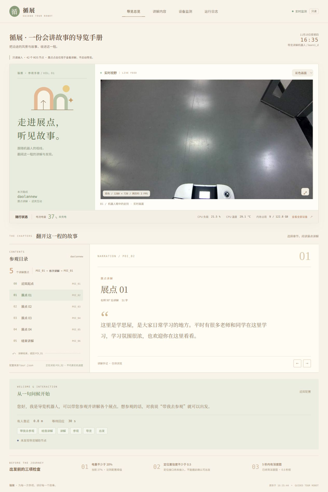

# 导览讲解机器人 · Guided Tour Robot

按预设路线带领游客参观的机器人项目：待机迎宾、语音确认出发、逐站导航和讲解、点位问答，最后返回起点继续待命。

本项目负责“按线路参观并讲解”；访客自主选择目的地的带路服务由 [visitor_wayfinding_robot](https://github.com/cisyam555/visitor_wayfinding_robot) 实现。

## 网页预览

「循展」是本项目的独立只读工作台，提供导览配置浏览、讲解内容检索、实时相机与设备监测。以下四张截图于 **2026 年 11 月 19 日连接机器人后实机采集**，记录当时的网页状态。

### 导览总览：路线、相机与讲解预览



- **实时视野**：查看头部相机画面，并在随行状态栏查看电量、CPU、温度和内存。
- **参观目录**：展示 `daolannew` 路线的起点、逐站展点及返回起点的配置。
- **讲解预览**：点击章节或前后翻页，浏览该展点的讲解词与转向配置。
- **迎宾与检查**：展示问候语、启动关键词、靠近距离及配置中的检查阈值。

章节选择仅用于阅读讲解稿，不会启动导航或播报，也不代表机器人当前到达的展点。定位接口尚未接入，页面中的检查信息不能单独作为出发依据。

### 讲解内容：逐站稿件与互动话术


- **逐站讲解**：集中浏览迎宾起点、各展点与结束讲解，核对点位编号、讲解内容及转向说明。
- **内容检索**：按展点、点位或讲解词查找内容。
- **互动话术**：查看出发欢迎、确认出发、去返程让行、恢复行走、结束及回到待机的配置话术。

内容来自项目的 `tour.json`，网页用于浏览；修改讲解词请编辑项目配置文件。

### 设备监测：主机、相机与服务状态


- **主机与电池**：查看电量、充电状态、CPU、温度和内存，并标明数据来源。
- **ROS 与相机**：查看节点数量、头部相机接收情况、深度图前方距离与语音服务发现情况。
- **未接入项目**：明确标注导航与讲解进度尚未接入、当前运行地图未查询，避免将配置值误认为运行状态。

节点或服务可发现表示监测到了对应接口，不等于完成实机功能验证。

### 运行日志：监测连接与 ROS 警告


- 按时间查看监测服务启动、电池连接、ROS 图连接及话题订阅等事件。
- 支持按 `INFO`、`WARN`、`ERROR` 筛选，暂停更新和导出日志。
- 目前收集监测连接事件与相关 ROS 警告，机器人终端中的完整导览输出尚未接入。

启动和访问方法见下方[网页启动](#网页启动)，更多说明见 [Web 工作台文档](web/README.md)。

## 完整流程

```text
读取配置 → 核对地图/点位 → 定位与出发自检 → 原地待机
                                                ↓
                                   有人靠近问候、等待参观指令
                                                ↓
起点 → 欢迎语 → 依次导航到展点 → 摆正/转向 → 讲解 → 点位问答
 ↑                                                   ↓
 └────── 返回起点、摆正、继续待命 ← 最后展点/提前结束导览
```

默认地图及路线为 `daolannew`：`POI_01 → POI_02 → POI_03 → POI_04 → POI_05 → POI_06 → POI_01`。默认采用点对点导航，路线顺序不等同于底盘实际行驶轨迹。

| 阶段 | 行为 |
| --- | --- |
| 待机 | 原地静止，有人靠近后问候；默认不摇摆 |
| 启动 | 听到“带我去参观”等关键词后开始 |
| 到点 | 按点位朝向摆正，再按配置转向展品 |
| 讲解 | 播放该点位的讲解词 |
| 问答 | 讲解后默认开放 10 秒窗口，可连续提问，空闲后继续 |
| 提前结束 | 问答窗口内说“不听了 / 结束导览 / 带我回去”，返回起点 |
| 正常结束 | 完成末站与结束话术，返回起点后继续待机 |
| 播报或模型异常 | 告警或降级，按程序继续导览流程 |

**当前语音边界：行走及讲解播报期间不收音。** 结束导览指令只在问答窗口内生效，不能把它当成全程可用的语音急停。

## 技术实现

- ROS 2 Jazzy / `ament_python`，包名 `learn1_d`。
- `map_nav_test.py` 负责流程，`nav_core.py` 通过底盘 REST SDK 管理异步任务、定位、转向和前向防撞。
- 平台 ASR 提供语音识别，平台 TTS 提供讲解播报；本项目不依赖 faster-whisper。
- OpenAI 兼容的 Qwen 接口用于点位问答；点位知识来自 `tour.json`，资料外的问题使用兜底回复。
- 网页独立监测；点击展点仅浏览配置，不下发导航。

## 环境与启动

依赖机器人上的 ROS 2 Jazzy、`/home/nvidia/xos` 平台环境、`/home/nvidia/robot_controller/src` 底盘 SDK、NumPy、已有头部深度相机和语音服务。网页另需 `psutil` 和 OpenCV。地图及 POI 由底盘保存。

```bash
cd /home/nvidia/guide_robot/learn/guided_tour_robot
source /opt/ros/jazzy/setup.bash
source /home/nvidia/xos/setup.bash
colcon build --packages-select learn1_d --symlink-install
source install/setup.bash
ros2 launch learn1_d tour.launch.py
```

默认启动后加载地图、自检并待机，听到参观指令后开始。不要同时运行其他控制底盘的导航项目。

先检查路线：

```bash
# 读取底盘地图与点位校验配置，不加载地图、不运动、不播报
ros2 launch learn1_d tour.launch.py plan:=true
```

## 配置路线、讲解与问答

主要配置文件：`src/learn1_d/learn1_d/tour.json`。

| 配置段 | 用途 |
| --- | --- |
| `route` / `map` | 固定路线标识与底盘地图 |
| `start` / `pois` / `return_poi` | 起点、依次访问的展点和回程终点 |
| `texts` | 欢迎、到达、结束及让行话术 |
| `voice` | 待机问候、启动关键词、靠近距离、等待时间 |
| `poi_scripts` | 各点位的转向角度、讲解词和问答资料 |
| `qa` | 模型接口、问答窗口、兜底回复和通用知识 |

示例：

```json
{
  "POI_02": {
    "turn_deg": -90.0,
    "text": "这里是本次参观的第一个展点。",
    "knowledge": ["该展点的真实介绍资料"]
  }
}
```

上面内容对应 `poi_scripts` 内的一个点位。`turn_deg` 正值左转、负值右转；讲解和问答资料应与现场一致。修改配置后重新构建，或通过 `config:=/绝对路径/tour.json` 指定配置文件。

## 常用启动参数

| 参数 | 默认值 | 含义 |
| --- | --- | --- |
| `config` | 包内配置 | 导览 JSON 路径 |
| `route` | 配置值 | 自定义路线时传 `custom` |
| `speed` | `0.3` | 导航限速，米/秒 |
| `timeout` | `180.0` | 单段导航超时，秒 |
| `reloc_poi` | `POI_01` | 重定位参考点 |
| `plan` | `false` | 只读路线校验 |
| `speak` | `true` | 播报开关 |
| `wait_voice` | `true` | 等语音指令后出发 |
| `guard` | `true` | 前向防撞 |
| `align` | `true` | 到点摆正 |
| `standby_only` | `false` | 只测试待机，收到启动指令后退出 |
| `sway_deg` | `0.0` | 待机腰部摇摆角度，0 关闭 |

```bash
# 指定另一份完整配置
ros2 launch learn1_d tour.launch.py config:=/path/to/tour.json

# 调低速度
ros2 launch learn1_d tour.launch.py speed:=0.15

# 只测试待机，不执行路线
ros2 launch learn1_d tour.launch.py standby_only:=true
```

固定路线与命令行点位冲突时会拒绝运行。改用命令行点位须传 `route:=custom`，再指定 `map`、`start`、`pois`、`return_poi`。

## 网页启动

```bash
cd /home/nvidia/guide_robot/learn/guided_tour_robot
bash web/start_monitor.sh --port 8767
```

浏览器访问 `http://<机器人IP>:8767/`。页面只读，不启动导览或播报。CPU、温度、电量及相机来自监测服务；章节选择来自配置，**不是实机导览进度**。定位、当前运行地图及任务进度尚未接入。

## 代码入口

| 文件 | 职责 |
| --- | --- |
| `src/learn1_d/learn1_d/map_nav_test.py` | 导览流程与命令行入口 |
| `src/learn1_d/learn1_d/nav_core.py` | 导航、定位、转向、防撞、自检 |
| `src/learn1_d/learn1_d/tour_config.py` | 参数与配置校验 |
| `src/learn1_d/learn1_d/tour.json` | 路线、话术、知识资料 |
| `src/learn1_d/learn1_d/voice_wait.py` | 待机和问答收音 |
| `src/learn1_d/learn1_d/poi_qa.py` | 点位问答、回声过滤、结束意图 |
| `src/learn1_d/launch/tour.launch.py` | 一键启动 |
| `web/` | 循展工作台及测试 |

## 异常处理与边界

- 出发前检查电量、定位置信度、深度图；默认阈值为电量不少于 20%、定位置信度不少于 0.5、5 秒内有深度图。
- 前方被挡时取消任务并等待让行，道路清空后续行；深度断流会停车中止。
- 单点失败可跳过，连续两点导航失败或安全功能失效会中止；转向或讲解失败按步骤降级。
- TTS 失败只告警，模型不可用使用兜底回复；问答依赖网络。
- 中止后先停车并尝试提示工作人员；返回起点也可能因定位、障碍或底盘异常失败，不能保证所有异常都能自动回程。
- 前向相机不覆盖所有方向，软件保护不替代硬件急停与现场人员看护。

网页离线校验：

```bash
cd web
python3 -m unittest test_monitor -v
node --check app.js
```

测试不会启动机器人；实机运动、定位与语音效果需另行验证。
